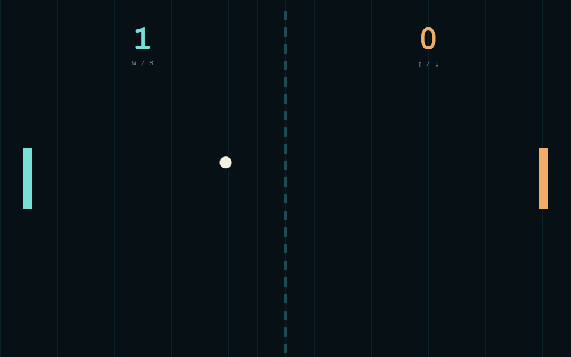

# Pong

A two-player Pong game hosted on Cloudflare Pages, with the original Python/tkinter edition kept in this repository for local desktop play.

## Play in your browser

Play it at [pong.eyesonflash.com](https://pong.eyesonflash.com/). The public game is on Cloudflare Pages. Use a modern desktop browser.




## Browser edition

The hosted game is [pong.eyesonflash.com](https://pong.eyesonflash.com/). No installation is required.

- **Two-player local multiplayer** — Player 1 uses W / S; Player 2 uses ↑ / ↓.
- **Angle-based paddle physics** — Edge hits create steep deflections and centre hits play flatter.
- **Progressive ball speed** — The rally accelerates after each paddle hit while staying playable.
- **Score tracking** — First player to 7 points wins.
- **Pause and resume** — Press Space during a match.
- **Fullscreen** — Press F to toggle fullscreen.

## Browser controls

| Action | Player 1 | Player 2 |
|---|---|---|
| Move | W / S | ↑ / ↓ |
| Start / Pause / Resume | Space | Space |
| Fullscreen | F | F |

## Original Python edition

`Pong.py` is the original lightweight tkinter version. It needs Python 3.8+ with tkinter, which is included with standard Python installations.

```bash
python Pong.py
```

The native edition uses the same two-player controls, first-to-seven scoring, progressive speed, and Space to start, pause, or resume.

## Local browser development

The public game is Cloudflare Pages. For local work, serve this folder with any static server. There is no build step or runtime dependency.

## License

MIT License — see LICENSE for details.
